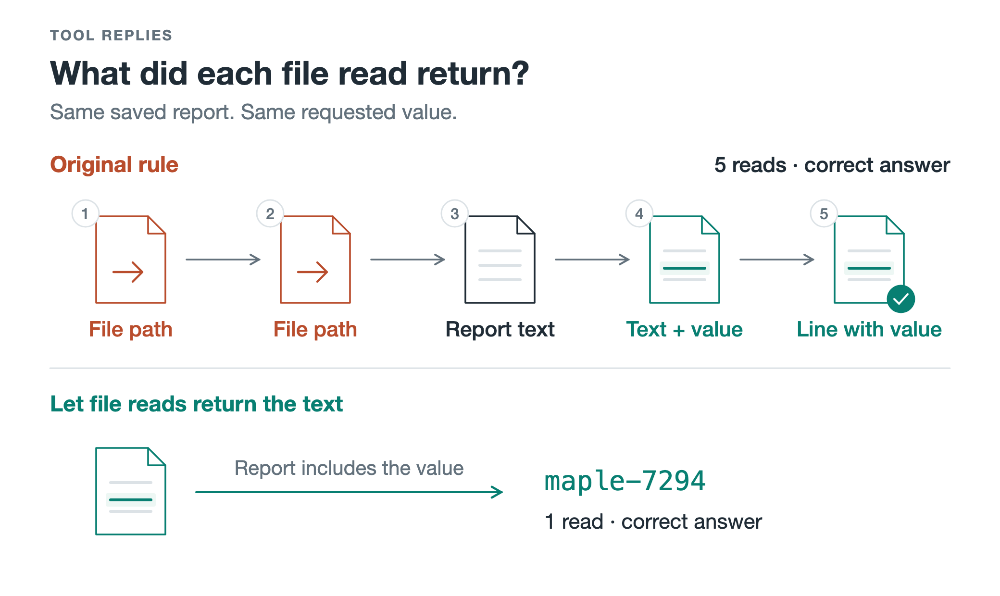
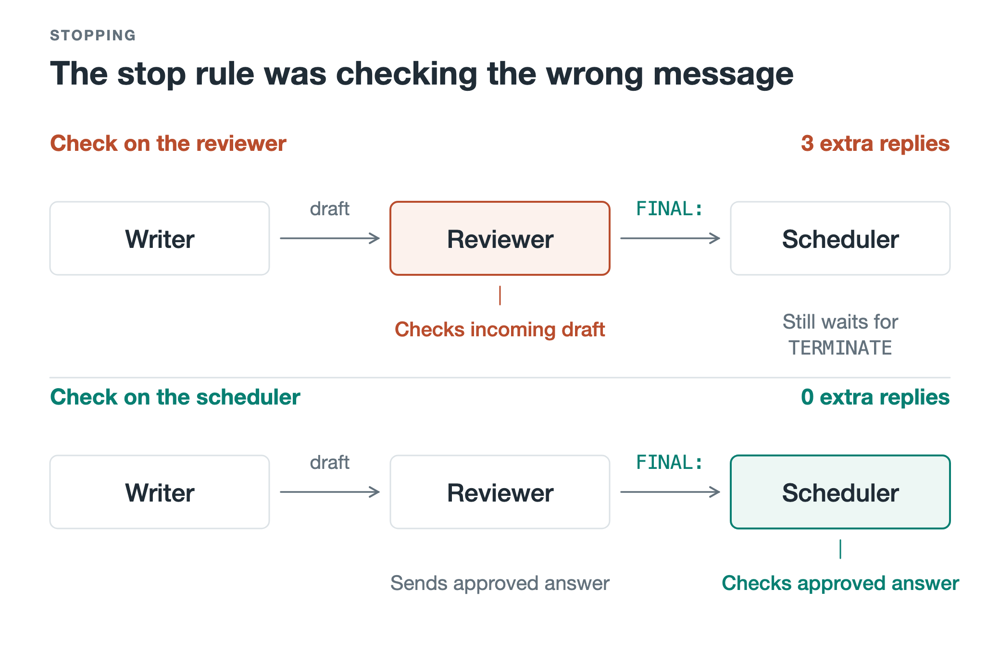
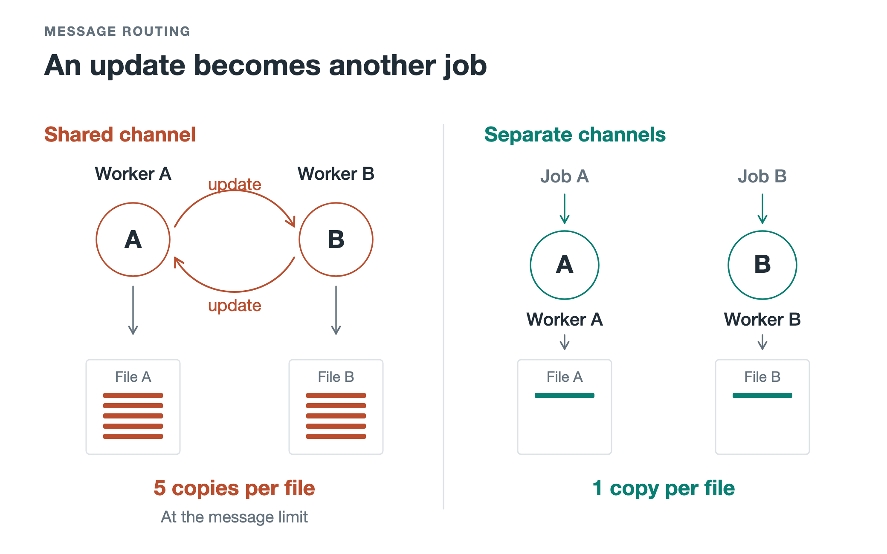
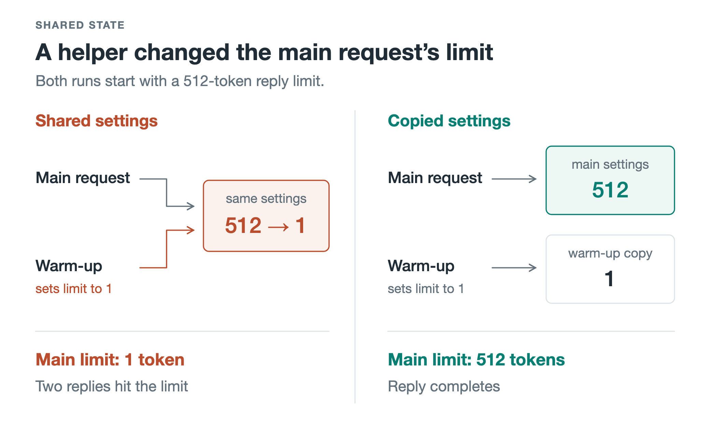
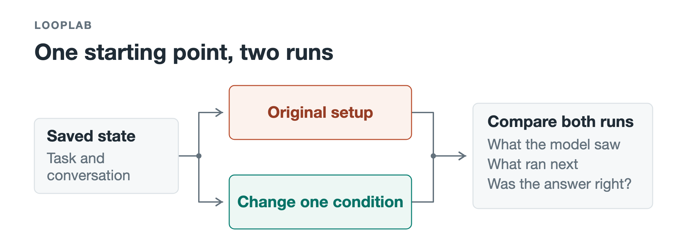
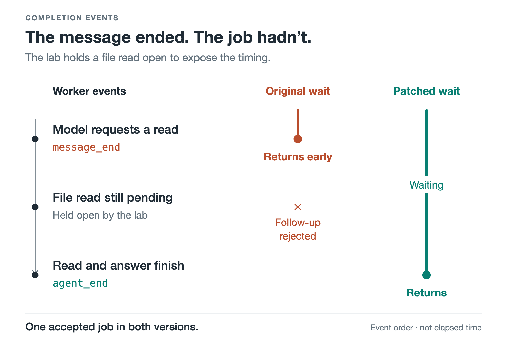

# Agent Loop Debugging Reference

This guide accompanies *Why Does My Agent Keep Looping?*. Start with the numbered examples for walkthroughs of common symptoms, or jump to the [five-layer field notes](#a-debugging-reference), [reproduction settings](#b-reproduction-notes), [experiment results](#c-results-for-all-40-cases) or [index by pattern](#d-find-cases-by-pattern).

When an agent keeps searching, ask what it could learn from the next lookup. It might find something useful about the files it has access to and still be unable to answer the user’s question. Let’s look at what the agent searched for when it couldn’t find the log it needed.

## 1. The search grows beyond the question

I asked an agent whether a particular run of a program had finished successfully. The evidence would be its log, a file recording how the run ended. The agent could look up the run in a local index that mapped run labels to log paths, or search the workspace directly. I deliberately kept the index entry and left out the log. The agent could answer “I can’t verify it.”

It searched the workspace, then looked up neighboring run labels in the index. Its explanation was that finding another log would show the index worked for at least one run. That would help diagnose the index. It would still leave the outcome of the requested run unknown.

I replayed the saved state after the initial local searches. Those earlier searches were still in the model’s input, and it kept proposing new lookups until my tool-call limit. In this replay, the search continued with its earlier history still visible.

A concrete search limit helped. Check the requested job once, search the local files once, then report an unknown result if neither produces evidence. The agent did so. That bounded the investigation. A definitive answer still required the missing log. [Try the missing-log lookup](https://github.com/henryzhz/code-samples/blob/ea4a480cb4c0b19b1796820a9175623266e1ceb3/agent-tool-loops/missing-log/lookup.py)

## 2. The tool keeps handing back filenames

In the missing-log case, the evidence wasn’t in the workspace. For the next case, let’s look at a file that exists but whose contents take several calls to reach the model. I had a tool generate a long report with `BUILD_CHECKSUM=maple-7294` near the end, and asked DeepSeek to copy the value after the equals sign.

Generating the report returned a filename. The system had saved the long tool reply to disk. The same rule applied when DeepSeek opened the file. Its first read got another filename, and opening that file on the second read produced yet another path.

DeepSeek then asked for smaller excerpts. The third read showed report text, the fourth contained the value, and a fifth isolated the line to check.

**I would keep that fifth read.** The model had found the answer and checked the line it was about to quote. Counting calls alone would make it look just as suspicious as the reads that yielded only filenames.



I replayed the first read with one change, allowing file reads to return their text directly. DeepSeek now answered correctly after one read.

Here the extra work led me to the tool’s handling of long replies. The model’s own smaller requests also found a way around it. [File-read example and pinned source](https://github.com/henryzhz/code-samples/tree/ea4a480cb4c0b19b1796820a9175623266e1ceb3/agent-tool-loops/offload)

## 3. The answer is approved, but someone schedules another turn

In the file case, the model kept requesting reads. Here the system kept scheduling speakers even after it had a correct answer. In an AutoGen test, one agent submitted a writing job. A reader received a project’s introductory document, a writer described the project in one sentence, and a reviewer checked the sentence. I also asked them to include a distinctive string from the document so I could check that its contents reached the answer.

The reviewer returned a correct sentence starting with `FINAL:`. Then the agent that had submitted the assignment repeated it. The reader repeated it too. Finally, the writer sent `TERMINATE` and the conversation ended.

The team’s **scheduler**, the code choosing the next speaker, was waiting for that exact word.

I had put an approval rule on the reviewer. It checked both that a message came from the reviewer and that it started with `FINAL:`. In AutoGen 0.2.9, however, the reviewer applied that check to *incoming* messages. It inspected the writer’s draft. Its own approval was an outgoing message, so the reviewer did not check it. The scheduler received that approval and still waited for `TERMINATE`.



Moving the approval check to the scheduler removed all three extra replies. The reader, writer and reviewer produced the same initial answers.

A model can finish speaking while the application still has more speakers queued. If the answer is already acceptable, follow the code that decides to call someone again. [AutoGen discussion](https://github.com/microsoft/autogen/issues/1464)

## 4. The retry repeats an approach that isn’t improving

A summarizer had two notes, one about setting up Python and pytest, the other about passing parser checks. It had to keep both facts while reducing twelve words to ten or fewer. The LangChain program summarized each note separately. Together, the replies contained fourteen words.

Fourteen exceeded the target, so the program tried to shorten the two summaries it had just produced. The total stayed at fourteen through three passes, with two model calls per pass.

I added a check that compared the total before and after each pass.

```text
if words_after <= 10:
    finish()
elif words_after >= words_before:
    stop("no progress")
else:
    retry()
```

The first pass grew from twelve words to fourteen. That triggered the check after two calls. A later pass might have worked, but I chose to abandon this approach early.

To get the summary, I combined the original notes in one request and explicitly asked for ten words or fewer. DeepSeek returned seven words preserving the setup tools and test result.

> Python and pytest setup; parser checks pass.

I changed both grouping and instruction, so I can’t isolate which helped. The practical distinction is between deciding to stop retrying and finding an approach that completes the task. [LangChain report](https://github.com/langchain-ai/langchain/issues/16251) · [retry-cap change](https://github.com/langchain-ai/langchain/pull/16253)

## 5. Two submissions can mean one job

A log can show a second request even when no second job starts.

I tested retry code from pi, a coding agent. My test program submitted a file-reading job and waited for it to finish. A test worker performed the read, using real DeepSeek replies.

I simulated an overload so pi would retry the original job, then held the file read open. Pi returned control to my test program while the original job was still waiting on the read. The test program then submitted a new request, which the worker rejected as “already processing.”

The retry code had returned on `message_end`. What had ended was the model’s *request to read*. The file still had to be read and the answer generated. Waiting for `agent_end`, after that work was complete, fixed the early return.

In both versions the original job eventually answered correctly. The failing trace had two submissions from my test program and one accepted job. Before diagnosing duplicate writes, check which requests actually reached a worker and changed anything. [pi’s retry completion fix](https://github.com/earendil-works/pi/pull/2440)

## 6. What I’d record next time

One of my own agents had kept asking for more lines from the same file. I hadn’t saved the replies. For a run like that, I want the text it actually received on two consecutive reads, plus the event that requested the second one.

That small slice could send me to very different fixes. New text might justify another read. Another filename might expose a tool problem. An approved answer followed by a fresh invitation to speak points toward scheduling.

The same tool name appearing twice gives me a place to start looking. The decision between those calls is what tells me where to intervene.

## A. Debugging reference

Once you have those records, use the notes below to find a case that matches your symptom. If you give the trace to an AI assistant, ask it to identify who requested each attempt, what came back and which entries support its explanation.

### A1. Task and strategy

Start with what the agent was asked to do. Could the next step answer that question?

#### A1.1 More tools give the agent more places to search

In a separate comparison from the capped replay in section 1, an agent had to report the outcome of a Python test run. I kept its index entry but supplied no result file. With only index tools available, one lookup produced an “unknown” conclusion, whether the reply was blank or explicitly said the file was missing.

Adding local file tools led to five calls with blank feedback and three with explicit feedback. All four runs stopped naturally, without repeating an identical call. Each setup ran once. All answers also missed the JSON-only format. An empty reply alone didn’t determine how long the search lasted.

#### A1.2 The program schedules a second specification

For a function that cleans up title spacing, historical gpt-engineer code requested a specification, a review and another specification before generating code. The rewrite happened whatever the review said. Removing those two stages reduced six model calls to four. Scripted replies produced identical files; live replies produced functions that passed seven checks. The reporter’s exact version is unknown.

A separate CrewAI 0.121.1 test asked which file contained `normalize_title`. I queued four documentation tasks or just that lookup, with one call per task. One task saved three calls. Both plans asked for clarification when the function name was omitted, and both answered correctly when it was supplied. Inspect the startup plan and what each worker receives. [gpt-engineer change](https://github.com/AntonOsika/gpt-engineer/commit/0d186e22e6e3ff904f4295a0088a7bdf1b31aea9) · [CrewAI report](https://github.com/crewAIInc/crewAI/issues/2938)

#### A1.3 Review introduces a missing dependency

I asked for a summary of a README describing Python and pytest. A review function could request one revision. I deliberately made it demand verification against a separate, unavailable report. The model asked the user for that report.

My keyword-based scoring initially accepted this reply, even though the summary was missing. Changing the feedback to check against the supplied README produced the summary. If review sends an agent searching elsewhere, compare that feedback with the original assignment. [Stop hook contract](https://code.claude.com/docs/en/hooks#stop)

#### A1.4 Two checks demand opposite edits

Imagine a row `a,b,`. Its importer expects three fields, with the last empty. A formatter asks the agent to remove the final comma. The importer then sees two fields and asks for the comma back.

This is hypothetical. Run both checks on the same revision to find out whether satisfying one necessarily breaks the other.

#### A1.5 The agent asks for more lines of the same file

My agent kept increasing the requested line count, then moved on. I hadn’t saved the replies.

Compare two actual replies from the same file version. The larger request might reveal new text, or both replies might be clipped at the same place. If the whole file was already visible, inspect what the agent wanted to check. The request size alone cannot tell you which happened.

### A2. Tools and context

If the evidence should be available, follow it from the file or service to the model’s input.

#### A2.1 “Next line” skips text the tool never displayed

I put a recognizable string 25,000 characters into a one-line file. The reader fetched the line, but its displayed reply ended before the string. Asking for line two skipped past the file. No continuation position addressed the hidden part of line one.

A separate script requested 8, 16 and 32 lines and got the same clipped preview. These scripted tests show how requested lines and displayed text can disagree. For a model’s repeated reads, also inspect the parameters it actually selected. [Upstream output-cap change](https://github.com/langchain-ai/deepagentsjs/pull/172)

#### A2.2 Different failures return the same blank reply

In section 1, the requested job was labeled `run-001`. Its index entry pointed to a missing log. The neighboring label `run-002` had no entry at all. Both lookups returned the empty string `""`.

The model could not distinguish an unknown job from a missing file using those replies. The offline sample shows both code paths. Whether distinct errors would stop the model trying other labels remains untested. [missing-log lookup](https://github.com/henryzhz/code-samples/blob/ea4a480cb4c0b19b1796820a9175623266e1ceb3/agent-tool-loops/missing-log/lookup.py)

#### A2.3 A tool supplies the answer and a broken path

A lookup returned a Python test log showing a successful exit and three passing tests. It also advertised `/artifacts/run-001.log`, although the file it had read was `/reviewer/run-001.log`. The separate file reader tried the advertised path and failed.

Making the file available there repaired the pending read. Both runs still reported the correct outcome because the lookup had already shown the contents, although the original answer missed the JSON format. Inspect the content as well as the path before concluding that a failed read hid the answer.

#### A2.4 A helper’s answer never reaches the parent

A parent agent delegated a user-count lookup. I scripted the helper to return 1,200 in a tool-result message, while the parent used a live model.

Deep Agents 0.7.21’s handoff code looked for a final assistant message. The parent got a blank reply, delegated again, searched files and eventually reported uncertainty. Putting 1,200 in an assistant message delivered it in one delegation.

Version 0.4.12, named in the public report, forwarded that plain-text tool result in my test. The reporter’s workflow also ended with an assistant message. That earlier incident remains unresolved. Compare the helper’s output with what the parent actually received. [Deep Agents handoff report](https://github.com/langchain-ai/deepagents/issues/2184)

#### A2.5 Information disappears before summarization

A README writer returned `UNKNOWN` for a build name it had received earlier. The code preparing a second conversation summary had skipped the message containing the name.

In another test, a build name, test command and Python version sat beyond a tool reply’s 2,000-character cutoff. They never reached the summarizer and were absent from the README. My test script then looked up those facts in the saved, uncut documentation and passed them to the writer. The writer recovered all three.

Follow a missing fact through the original reply, summary input and writer’s prompt. Whether the model would have requested that lookup on its own was untested. [retained-message fix](https://github.com/earendil-works/pi/commit/eeace79715d93d413b5a479e380a7a3c74a1a245) · [serializer change](https://github.com/earendil-works/pi/commit/c950c692a171d001b655b30555c7d49cbf1d7820)

#### A2.6 An old instruction reappears

I used Codex’s conversation-building code to restore a completed README request alongside an unfinished documentation task. DeepSeek left the finished file alone under both the existing prompt and a proposed replacement. Explicitly asking for a recheck produced one read.

The old instruction appeared in all cases. To show that finished work reopened, find a new action on the file and what triggered it. [unmerged Codex proposal](https://github.com/openai/codex/pull/8605)

#### A2.7 The parser rejects a valid tool request

The agent sent a README as a JSON string containing a Markdown code sample. LangChain 0.0.262 treated triple backticks inside that string as the end of the whole request. Its JSON parser received incomplete text.

Using a JSON decoder to find the boundary recovered the action from the same reply. Save the raw message before asking for a replacement. This comparison contained no retry. A separate CrewAI correction test used deliberately malformed scripted replies; its live-model control finished normally. [LangChain parser report](https://github.com/langchain-ai/langchain/issues/9535)

### A3. Scheduling and stopping

If the evidence or answer is already available, check which rule or actor asked for another turn.

#### A3.1 The request forces a tool call after the answer is available

A local code search had shown the complete `normalize_label` function. The user wanted its output for `'  Hello World  '`, which the model could determine as `hello-world`.

With that search result still visible, I required another tool call or allowed a direct answer.

| Setting | File still available | File now unavailable |
|---|---|---|
| `tool_choice="required"` | Four further requests, then limit | Four further requests, then limit |
| `tool_choice="auto"` | Correct answer immediately | Correct answer immediately |

The model could choose tools under `required`, but answering directly was unavailable. Check the request sent after evidence arrives. An earlier test looking specifically for repeats of one search tool missed its target; this broader follow-up was defined separately. [Saved request, four archived continuations, and comparison script](https://github.com/henryzhz/code-samples/tree/ea4a480cb4c0b19b1796820a9175623266e1ceb3/agent-tool-loops/tool-choice)

#### A3.2 The application loses the ending signal

I captured a correct DeepSeek reply and deliberately changed its ending signal before OpenCode 1.2.26 received it. The answer text stayed intact.

With `stop`, OpenCode went idle. Removing the ending event, or changing `stop` to `unknown`, produced two extra answer requests before my limit. Restoring `stop` removed them.

I supplied the fault; OpenCode chose to continue. The public incident lacked the provider events needed to establish the same cause there. Compare what the provider sent with what the application received. [Original OpenCode issue](https://github.com/anomalyco/opencode/issues/17516)

#### A3.3 A question appears, but control never reaches the user

A reviewer needed to ask the user who a README was for. In a scripted AutoGen Swarm 0.4.5 exchange, it sent a question as ordinary text. The scheduler still gave the next turn to the reviewer. I supplied four empty follow-up replies. An explicit handoff returned control after two requests.

All four live-model comparisons ended in two requests each. DeepSeek handed control to the user when the audience was missing and completed the review when it was specified. The empty replies belong to the script. Check who gets the turn after a question appears. [AutoGen Swarm discussion](https://github.com/microsoft/autogen/discussions/5869)

#### A3.4 Review rejects every answer

I gave Claude Code a README-summary task and a Stop hook that deliberately rejected every answer. Even an accurate summary triggered another turn.

My test stopped version 2.1.142 after three answers. Limiting version 2.1.143 to one extra turn produced two answers, a successful process exit and an empty result for the caller. In a separate setting, letting the hook accept the next summary delivered the text.

Check both the review decision and what the caller received. A correct internal answer and a clean exit did not ensure delivery here. [Stop hook documentation](https://code.claude.com/docs/en/hooks#stop)

#### A3.5 A failed request triggers review without an answer

My local service rejected every request with HTTP 400, meaning invalid request. I configured the stop hook, a function that decides whether work should continue, to always ask for another turn. Claude Code 2.1.77 ran it after each rejection, and the hook prompted another request to the same service. The test saw six errors and six hook calls without a model answer. Version 2.1.78 returned the first error immediately.

Both versions recovered from a temporary HTTP 500 error in a separate check. Before examining what a reviewer disliked, establish whether the model produced an answer. [StopFailure hook contract](https://code.claude.com/docs/en/hooks#stopfailure)

#### A3.6 Delegation resets the turn allowance

I told a CrewAI 0.1.6 writer and researcher to seek colleague confirmation. Each delegation started a new invocation with its own turn allowance. The writer could ask the researcher on its first turn. The researcher could ask the writer back while the first invocation was still waiting. With either one or three turns per invocation, the chain reached my limit of four nested calls.

Refusing delegation back to a waiting role held the depth to two and produced the README. A separate instruction telling the researcher to answer directly still led to self-delegation. Its input retained the writer’s earlier request for confirmation; that influence remains untested.

Record who is waiting for whom. Check that any restriction still permits useful cooperation. [CrewAI delegation discussion](https://github.com/crewAIInc/crewAI/issues/6)

#### A3.7 Workers turn updates into new jobs

I adapted an AutoGen Core 0.4.2 example so two workers appended model-written sections to files. Both listened to the same channel. In the test, receiving an update ran the handler that appended a section and sent another update. So A’s update triggered a write by B, and B’s update triggered a write by A.



I capped new broadcasts at eight. A broadcast could reach multiple recipients, and the cap didn’t remove messages already queued. Workers handled those messages and wrote before trying to publish again. When the queue drained, each file contained five copies. Separate channels produced one each. Removing a worker left one file untouched.

Identify each write’s triggering message. Here the workers created fresh work for one another. [AutoGen two-worker report](https://github.com/microsoft/autogen/issues/5317)

### A4. State and recovery

If the program retries or resumes, compare the settings and saved state it uses on each attempt.

#### A4.1 A helper changes the main request’s settings

In a synthetic LoopLab test, a preliminary request warmed the cache before the main task. The warm-up needed almost no reply, so it set a one-token limit. It used the same settings as the main request and overwrote that request’s 512-token limit.



*LoopLab case C09. Both runs began at the same checkpoint, before the warm-up.*

I checked the same settings problem separately in Aider’s code. The main request should return `SYNTHETIC_LOG_OK`. It returned `SY`. My script requested a continuation and got `SY` again. Both requests still allowed one token.

Aider’s patch copied the settings before changing them for the helper. The main answer then arrived whole. Compare outbound settings before and after helpers run. The original application’s retry count is unknown. [Aider patch](https://github.com/Aider-AI/aider/commit/f2e1e177414bad2a50fb99b73b06d575f722a690)

#### A4.2 The retry preserves oversized settings

My simulated service rejected requests above 10,000 output tokens and returned a saved answer for smaller ones.

Claude Code 2.1.217 kept requesting 32,000 output tokens, with 31,999 reserved for reasoning. Three requests failed and I blocked a fourth. Version 2.1.218 reduced them to 9,000 and 8,999, so my service accepted it. Starting reasoning at 1,024 also let the older version shrink enough.

The saved answer came from a separate DeepSeek request allowing 350 output tokens with thinking disabled. This tests the clients’ recovery decisions under a simulated limit. Compare both allowances on the failed request and its retry. [Claude Code change history](https://github.com/anthropics/claude-code/blob/main/CHANGELOG.md)

#### A4.3 An old measurement triggers another summary

Pi can shorten a conversation by summarizing it. My test set a threshold of 437 tokens. A reading of 438 justified a summary.

After shortening, the old code reused that reading and requested another summary. Ignoring measurements from before the last shortening removed one call. Both versions still answered correctly. Without intervening shortening, the high reading correctly triggered one summary. Check which conversation version the measurement describes. [usage-measurement fix](https://github.com/earendil-works/pi/commit/d5c18e024812f298cc1cd64be6df23523caa66f9)

#### A4.4 Instructions refill the input after summarization

I gave Claude Code 1.0.89 1,500 made-up permission rules and asked it to summarize the conversation. The summary request omitted the rules. The next ordinary request included them again, so the summary alone understated what the model would receive next.

I tested repeated automatic summaries separately. This time I supplied a high usage reading after each summary to see what the client would do. Version 2.1.87 summarized six times before my limit; 2.1.89 errored after three. The readings came from me. Connecting those repeats to returning instructions would require the rebuilt inputs and the measurements that actually triggered them. [permission-rule report](https://github.com/anthropics/claude-code/issues/6461) · [compaction change history](https://github.com/anthropics/claude-code/blob/main/CHANGELOG.md)

#### A4.5 The update says success, but the cache stays old

I adapted a test about refreshing a test credential into an offline example with a document catalog and scripted model messages. The job was complete when the cache reached revision 1. I made the refresh announce revision 1 while the cache still held revision 0.

The controller checked the cached value, saw the job as unfinished and started another round. It refreshed seven times before my limit. Saving revision 1 on the first update reduced that to one. Read the value through the agent’s interface, then find who requested another refresh. [LoopLab runner](https://github.com/henryzhz/code-samples/tree/ea4a480cb4c0b19b1796820a9175623266e1ceb3/agent-tool-loops/looplab)

### A5. Queues and execution

Once a request leaves the agent, check which job a worker actually starts and what it changes.

#### A5.1 Retry policies multiply requests

Suppose a library tries a service three times, then returns one failure to its caller. The caller allows another attempt, giving the library three more tries. One operation could generate six requests.

That example illustrates how retry limits combine. In a separate Model Context Protocol client test, I checked which operations the client retried under repeated HTTP 503 “unavailable” errors. Listing tools took three attempts. Invoking a tool took one. Group service requests by their originating operation before counting them as fresh agent decisions. [layered retry budgets](https://aws.amazon.com/builders-library/timeouts-retries-and-backoff-with-jitter/) · [tested transport’s retry rules](https://github.com/openai/codex/blob/c2f7fe89d87ce853900d0b5cb1f5dc4863e44d73/codex-rs/rmcp-client/src/streamable_http_retry.rs)

#### A5.2 A queue redelivers a slow job

Imagine an Amazon SQS worker collects a report job that takes 90 seconds. The queue hides it from others for 60 seconds. When that period expires, another worker may receive it while the first still writes, unless the first extended the timeout or removed the message.

This illustrates the queue contract; I didn’t execute this two-worker scenario. Match message IDs across deliveries and inspect progress and timeout extensions. [Amazon SQS visibility timeout and redelivery](https://docs.aws.amazon.com/AWSSimpleQueueService/latest/SQSDeveloperGuide/sqs-visibility-timeout.html)

#### A5.3 A write succeeds and its reply disappears

Imagine a service saves a report, but the reply carrying its ID never reaches the caller. The caller times out and sends a fresh create request, which can produce another report.

To test this, assign an operation ID before the first request. Save the report, drop its reply and retry with the same operation ID. Storing that ID with the report lets the service recognize the retry. A genuinely new request gets a new ID. The identifying information must survive the lost reply. [AWS on idempotent operations and ambiguous timeouts](https://aws.amazon.com/builders-library/making-retries-safe-with-idempotent-APIs/)

#### A5.4 Resuming approval repeats an audit write

LangGraph restarts a paused function from its beginning when work resumes. Consider this hypothetical external audit write.

```text
def review(req_id):
    audit.append(req_id, "requested")
    return interrupt("Approve?")
```

The first call writes and pauses. On approval, `review` starts again and appends another entry before the pause returns the decision.

Approve once and count entries for that request. To record “approval requested,” make the ID and event unique. To record approval granted, write after a positive decision. [LangGraph node execution and interrupts](https://docs.langchain.com/oss/javascript/langgraph/thinking-in-graph-api)

#### A5.5 A stale edit removes completed work

Imagine two editors open revision 7. One adds a citation and saves revision 8. The other fixes a heading in its old copy and saves the whole document. The citation disappears, prompting another review request.

This is hypothetical. Find the write where the citation vanished and each editor’s starting revision. Applying the heading change to the current version would preserve both edits.

#### A5.6 Cancelled work finishes late

Mastra checked for cancellation before looking up the tool. I cancelled the call while that lookup was still in progress. When the lookup finished, the old code went ahead with the file read and then saved `Aborted` as the tool result.

The patched code checked again before executing the tool and skipped the read and save in that scenario. When I cancelled after the read, both versions had already read the file. Only the old code saved the `Aborted` result. Without cancellation, both versions read and saved once.

These records show late work on the original call. A restarted job would require a second start event. [Mastra cancellation change](https://github.com/mastra-ai/mastra/pull/13491)

#### A5.7 The caller keeps polling “connecting”

My test program asked for connection status twelve times; the service answered “connecting” each time. Every call returned normally. The twelve requests came from the program I wrote.

In another comparison, the second poll returned “ready,” so a follow-up learned something. For an unexplained repetition, inspect who schedules the next poll and what condition would stop them. The client trace alone cannot establish the original incident’s cause. [pinned MCP client](https://github.com/openai/codex/blob/c2f7fe89d87ce853900d0b5cb1f5dc4863e44d73/codex-rs/rmcp-client/src/streamable_http_retry.rs)

## B. Reproduction notes

The five walkthroughs and 31 field notes are organized around symptoms readers can look up. They use lab tests, worked examples and an observed run. Some revisit the same experiment. The results table in section C has a separate purpose. It counts the 62 pairs from the 40 synthetic lab cases. The walkthroughs also draw on later experiments with framework code.

The runs had call limits. A run stopped by its limit might have ended naturally later. [Results from the 62 paired trials](#c-results-for-all-40-cases)



Some details matter if you repeat the numbered examples.

- [Missing log](#1-the-search-grows-beyond-the-question). The nine-call replay resumed after the initial directory listing and filename search. The bounded-search prompt, and the explicit empty-directory reply, were separate interventions.
- [File reads](#2-the-tool-keeps-handing-back-filenames). DeepSeek chose the five reads. The offline script deliberately follows six returned paths before its limit. The live run used `deepseek-flash`, temperature 0, thinking disabled and 700 output tokens.
- [Approval and scheduling](#3-the-answer-is-approved-but-someone-schedules-another-turn). Both live branches produced the same first three replies. A separate scripted check confirmed that a reader could not terminate early with `FINAL:`. The live pair used the same model and temperature as section 2, with 512 output tokens and eight group messages. The public incident lacked the transcript needed for the same diagnosis.
- [Summary retries](#4-the-retry-repeats-an-approach-that-isnt-improving). The original summaries stayed at fourteen words through three passes. Separately, a scripted comparison kept shrinking different notes and reached fourteen words against a fifteen-word target in ten calls. This is why a fixed call cap can also interrupt useful progress.
- [Early return from pi](#5-two-submissions-can-mean-one-job). The test used pi’s session and retry methods with adapters around them, a locally injected overload and real model replies. Both original and fixed code eventually answered correctly in all four runs, including the two without overload.



*The file read was held open in both runs so I could see exactly when each caller returned.*

LoopLab uses Deep Agents to run tasks, DeepSeek for model replies and LangGraph to save steps in SQLite. The companion repository has the runner and 40 synthetic tasks. From `code-samples/agent-tool-loops/`, these two examples work offline with Node 24.19.0 and Python 3.12 respectively. [Companion code](https://github.com/henryzhz/code-samples/tree/ea4a480cb4c0b19b1796820a9175623266e1ceb3/agent-tool-loops)

```sh
node offload/eviction_poc.mjs
python3 tool-choice/compare.py
```

The Python script compares the four saved runs in A3.1. Optional `--live` mode requests the next decision under `required` and `auto`, permits two provider requests and executes no tools. The saved runs used `deepseek-flash`, temperature 0, 512 output tokens, thinking disabled, reasoning effort `none`, parallel tool calls disabled and no specified seed.

Across the five walkthroughs and 31 field notes, 29 begin with a lab test, six with a worked or hypothetical example and one with my observation without saved replies.

## C. Results for all 40 cases

This table covers the initial batch of 40 synthetic cases. I wrote down a particular symptom for each one. I ran its original setup and a changed version as a pair. For the 11 cases where the original setup missed its symptom on the first try, I ran two more pairs each. That made 62 pairs, 124 runs, 456 model calls and 429 tool executions.

Thirty of the 40 cases showed their target symptom at least once. In 25 cases the symptom cleared in at least one pair. Some rows measured an omitted fact or a tool call that never got dispatched. Those numbers count the outcomes named in the rows. They can’t tell us how often agents get stuck or whether every user got a good final answer.

**Seen / tried** tells you how many original runs showed the symptom. **Cleared** counts pairs where the original showed it and the changed run ended without that symptom, a runtime error, a timeout or a budget cutoff. Answer quality still needs a separate check. Take C01. In the original run, two file reads returned only filenames. The changed tool stopped doing that, but the run later exhausted its tool-call budget. That’s why the row reads **1/1, 0**. Section 2 describes a separate follow-up with the original file-reading code, where both versions finished.

| Symptom the experiment looked for | Seen / tried | Cleared |
|---|---:|---:|
| C01 · Trying to read a saved tool reply returned another filename at least twice. | 1/1 | 0 |
| C02 · The agent proposed the same archive operation after it was rejected. | 0/3 | 0 |
| C03 · Two separate model messages requested handbook searches that both succeeded. | 1/1 | 1 |
| C04 · The same SQL query succeeded twice. | 0/3 | 0 |
| C05 · The parent delegated the same arithmetic task twice. | 0/3 | 0 |
| C06 · The parser rejected a worker reply at least twice. | 1/1 | 1 |
| C07 · The agent looked up the same employee’s availability at least three times. | 0/3 | 0 |
| C08 · At least three attempts to open the calendar failed. | 0/3 | 0 |
| C09 · A one-token output limit cut off at least two replies after cache warm-up. | 1/1 | 1 |
| C10 · The program used an old conversation length and asked for at least two unnecessary summaries. | 1/1 | 1 |
| C11 · After an error I supplied, the program skipped at least two checks for a conversation too long to fit. | 1/1 | 1 |
| C12 · The input to a summary exceeded the lab’s character limit. | 1/1 | 1 |
| C13 · While shortening the conversation, the program asked an agent to continue a turn it had already finished. | 1/1 | 1 |
| C14 · The controller retried at least twice after a summary failed to get shorter. | 1/3 | 1 |
| C15 · Even after two summaries of the conversation, the next request still wouldn’t fit. | 1/1 | 1 |
| C16 · Restoring a task list marked completed work as open again. | 1/1 | 0 |
| C17 · The agent asked to connect to an editor that was already connected. | 0/3 | 0 |
| C18 · The model asked for a build check in three separate messages. The code meant to catch repeats let all three through. | 0/3 | 0 |
| C19 · The task finished but the command-line process stayed open. | 1/1 | 1 |
| C20 · The reviewer asked the user for an order ID, but the program still expected the agent to speak next. | 1/1 | 1 |
| C21 · A countdown message for one workflow reached the other workflow. | 1/1 | 1 |
| C22 · The scheduler gave an agent another turn after the answer was ready. | 1/1 | 1 |
| C23 · The program treated a returned assignment as a new job and sent the same work back to an agent. | 1/1 | 0 |
| C24 · A plan or paragraph repeated while the requested file was still missing. | 0/3 | 0 |
| C25 · After shortening the conversation, the program put the same waiting content back into it more than once. | 1/1 | 1 |
| C26 · At least two injected API errors triggered a hook that requested another turn. | 1/1 | 0 |
| C27 · A stop hook scheduled more work after exceeding its limit. | 1/1 | 1 |
| C28 · The program asked a skill to run while an earlier call to that skill was still active in the same chain. | 1/1 | 0 |
| C29 · The request was too big. The program sent it again at the same size. | 1/1 | 1 |
| C30 · The client refreshed its test credential at least twice and still couldn’t connect. | 1/1 | 1 |
| C31 · The output was ready while the process was still waiting for a worker. | 1/1 | 1 |
| C32 · A tool reply exceeded the lab’s 1,800-character display limit. | 1/1 | 1 |
| C33 · At least three configuration validation errors triggered the stop rule. | 0/3 | 0 |
| C34 · A completed job occupied a worker slot and blocked another job. | 1/1 | 1 |
| C35 · A message the agent needed was missing after the program shortened the conversation a second time. | 1/1 | 1 |
| C36 · After a retry, the program told its caller it could continue while a tool was still working. | 1/1 | 1 |
| C37 · The model finished sending its reply, but a tool call it had requested still hadn’t been sent to the worker. | 1/1 | 1 |
| C38 · A child ran a tool or saved a result after its parent was cancelled. | 1/1 | 1 |
| C39 · One step stayed within its step limit but exceeded its simulated time budget. | 1/1 | 1 |
| C40 · The code reading the model’s requested action reported an error when the document included a Markdown code block. | 0/3 | 0 |

C14 illustrates why the denominator matters. Only the middle one of three original runs showed a stalled summary. In C02 the proposed repeat never happened in three attempts. These small, selectively repeated experiments describe particular runs. A production frequency estimate would require different sampling.

## D. Find cases by pattern

Use this index to jump from the article’s six patterns to the detailed evidence. The cases are grouped by what to check first. Read the individual case to see whether it describes an observed repeat, a component test, a comparison that ran normally or an illustrative scenario.

| Pattern | Cases |
| --- | --- |
| **The search drifts from the task** | [Walkthrough 1](#1-the-search-grows-beyond-the-question), [A1.1](#a11-more-tools-give-the-agent-more-places-to-search), [A1.3](#a13-review-introduces-a-missing-dependency), [A1.4](#a14-two-checks-demand-opposite-edits) |
| **A component gets an incomplete message** | [Walkthrough 2](#2-the-tool-keeps-handing-back-filenames), [A2.1](#a21-next-line-skips-text-the-tool-never-displayed), [A2.2](#a22-different-failures-return-the-same-blank-reply), [A2.3](#a23-a-tool-supplies-the-answer-and-a-broken-path), [A2.4](#a24-a-helpers-answer-never-reaches-the-parent), [A2.5](#a25-information-disappears-before-summarization), [A2.7](#a27-the-parser-rejects-a-valid-tool-request) |
| **The workflow asks for another turn** | [Walkthrough 3](#3-the-answer-is-approved-but-someone-schedules-another-turn), [A1.2](#a12-the-program-schedules-a-second-specification), [A3.1](#a31-the-request-forces-a-tool-call-after-the-answer-is-available), [A3.2](#a32-the-application-loses-the-ending-signal), [A3.3](#a33-a-question-appears-but-control-never-reaches-the-user), [A3.4](#a34-review-rejects-every-answer) |
| **An output comes back as new work** | [A3.5](#a35-a-failed-request-triggers-review-without-an-answer), [A3.6](#a36-delegation-resets-the-turn-allowance), [A3.7](#a37-workers-turn-updates-into-new-jobs) |
| **The retry keeps the failing condition** | [Walkthrough 4](#4-the-retry-repeats-an-approach-that-isnt-improving), [A2.6](#a26-an-old-instruction-reappears), [A4.1](#a41-a-helper-changes-the-main-requests-settings), [A4.2](#a42-the-retry-preserves-oversized-settings), [A4.3](#a43-an-old-measurement-triggers-another-summary), [A4.4](#a44-instructions-refill-the-input-after-summarization), [A4.5](#a45-the-update-says-success-but-the-cache-stays-old) |
| **A request and its execution get out of sync** | [Walkthrough 5](#5-two-submissions-can-mean-one-job), [A5.1](#a51-retry-policies-multiply-requests), [A5.2](#a52-a-queue-redelivers-a-slow-job), [A5.3](#a53-a-write-succeeds-and-its-reply-disappears), [A5.4](#a54-resuming-approval-repeats-an-audit-write), [A5.5](#a55-a-stale-edit-removes-completed-work), [A5.6](#a56-cancelled-work-finishes-late), [A5.7](#a57-the-caller-keeps-polling-connecting) |

**A repeat without enough trace to diagnose.** [A1.5](#a15-the-agent-asks-for-more-lines-of-the-same-file) records my original repeated file reads. I’d need the actual replies to tell whether the reads kept uncovering new information.

For evidence on the broader lab batch, see [the 40 case results](#c-results-for-all-40-cases). Some runs measured a lost fact, a blocked job or an early return. Those observations can guide an investigation even when the test did not observe another action.
